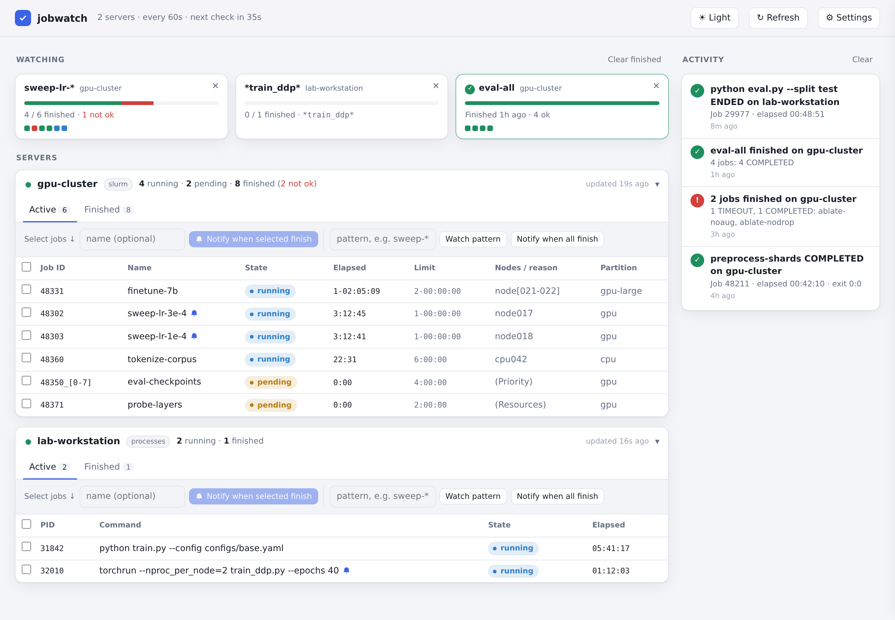

# jobwatch

<picture>
  <source media="(prefers-color-scheme: dark)" srcset="docs/screenshot-dark.png">
  
</picture>

<sub>Demo data.</sub>

A desktop app that watches your jobs on remote servers and notifies you when they finish.

- Lists the servers in your `~/.ssh/config`. You tick the ones to watch.
- On Slurm clusters it shows your running, pending and recently finished jobs, with their state and exit code. On servers without Slurm it tracks your processes that match a pattern (default: `python`, `torchrun`, …).
- **Watches:** select jobs (or give a name pattern like `sweep-*`, or "all jobs on this server") and get one notification when the whole set is done, with how many completed or failed.
- Optionally sends a notification for every job that finishes.
- Notifications go to your desktop, and optionally to your phone through [ntfy](https://ntfy.sh).
- Keeps checking in the background after you close the window. It can also start at login.
- Jobs that end while jobwatch is closed are reported the next time it runs.

## Install

**Linux (Mint, Ubuntu, Debian, others) and macOS.** Paste this into a terminal:

```
curl -fsSL https://raw.githubusercontent.com/kr-ramesh/jobwatch/main/get.sh | bash
```

On Mint, Ubuntu and Debian this installs the latest `.deb` with apt, so it asks for your password. On other Linux it installs for your user only, into `~/.local`. Then open **jobwatch** from your app menu, or run `jobwatch`. To update later, run the same command again.

**With pipx or pip:**

```
pipx install git+https://github.com/kr-ramesh/jobwatch
```

or `pip install --user git+https://github.com/kr-ramesh/jobwatch`. Then run `jobwatch`. This route doesn't add an app-menu entry. Get pipx on Mint/Ubuntu with `sudo apt install pipx`. Newer Mint and Ubuntu block `pip install` into the system Python, so use pipx there.

**By hand:** download `jobwatch_<version>_all.deb` from the [latest release](https://github.com/kr-ramesh/jobwatch/releases/latest) and double-click it. Or clone the repo and run `./install.sh` (`./install.sh --uninstall` removes it).

## Server requirements

jobwatch runs `ssh <host>` without a terminal, so each server must log in **without a password or 2FA prompt**:

- Key-based login works out of the box. On Mint, the login keyring unlocks your SSH keys.
- For servers with 2FA, turn on connection sharing in `~/.ssh/config`. Then log in once in a terminal, and jobwatch reuses that connection while it stays open:

  ```
  Host mycluster
      ControlMaster auto
      ControlPath ~/.ssh/cm-%C
      ControlPersist 12h
  ```

Nothing is installed on the servers. Each check runs `squeue` and `sacct` (or `ps`) through ssh.

## Command line

```
jobwatch                    open the window (starts background checking if needed)
jobwatch --hosts a b        also watch servers a and b
jobwatch --browser          open in a browser tab instead of an app window
jobwatch --quit             stop background checking
jobwatch --service          run the checker in the foreground (logs to the terminal)
```

Settings, watches and history are stored in `~/.config/jobwatch/`. The checker's log is `~/.config/jobwatch/service.log`.

## Privacy

The dashboard is served only on `127.0.0.1`. Job data stays on your machine, unless you set an ntfy topic: then notification text (job names and states) is sent to that ntfy server.

## Building the .deb

```
./build-deb.sh        # writes dist/jobwatch_<version>_all.deb
```

Bump `__version__` near the top of `jobwatch.py` for each release. The `.deb` and pip both read it from there.

To update an installed copy: install the new `.deb` over the old one, then run `jobwatch --quit` and reopen jobwatch so the background checker runs the new version.

## License

GPL-3.0. See [LICENSE](LICENSE).
